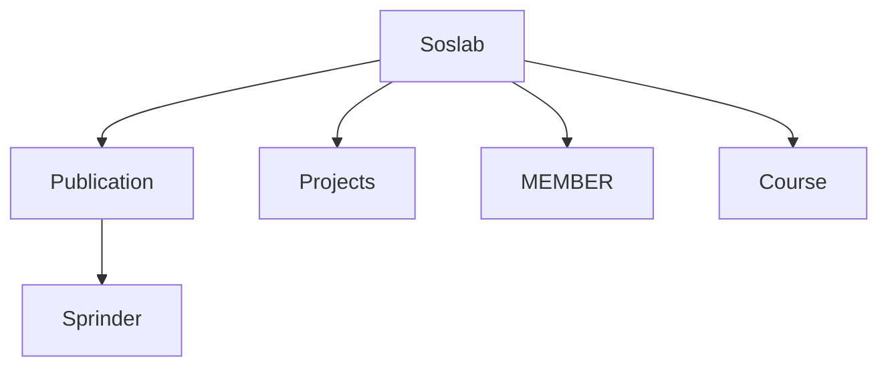
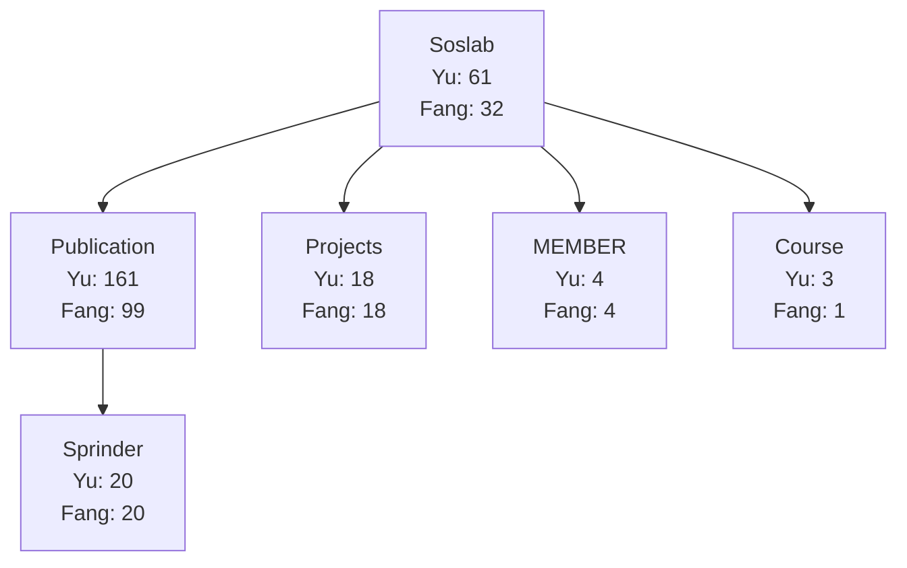
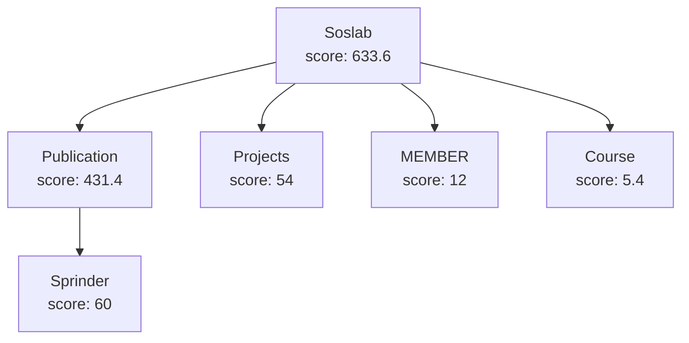

# HW6 - Compute the score of a website!
- Input
    - A set of keywords, the size of this set is N
    - N [keyword.name1 keyword.weight1] [name2 weight2] […] [nameN weightN] 
    - e.g. 2 Yu 1.2 Fang 1.8
    - A single execution may receive multiple such lines, one after another, until the input ends — your program should process and print a full tree for each line it reads.
- Output: The whole WebTree structure

## Class for HW6
1. Main
2. Keyword : Store keywords
3. WordCounter : Count keyword occurrences
4. WebPage : Calculate webpage score
5. WebNode : Define the relationship between the parent and child nodes and store the accumulation score calculated by the WebPage
6. WebTree : Define tree

### 1. Main
- Main Webpage
    Webpage (“URL”, ”Given website name”)
    ```java
    WebPage rootPage = new WebPage("http://soslab.nccu.edu.tw/Welcome.html", "Soslab");
    ```
- Sub Webpage (Attached to the main webpage)
    `tree.root.addChild` : Root node add child node
    `tree.root.children.get(0).addChild` : Take child node whose index is 0 and add child node
    ```java
		tree.root.addChild(new WebNode(new WebPage("http://soslab.nccu.edu.tw/Publications.html","Publication")));
		tree.root.children.get(0).addChild(new WebNode(new WebPage("https://link.springer.com/book/10.1007/978-3-319-68670-7", "Sprinder")));
		tree.root.addChild(new WebNode(new WebPage("http://soslab.nccu.edu.tw/Projects.html","Projects")));
		tree.root.addChild(new WebNode(new WebPage("http://soslab.nccu.edu.tw/Members.html", "MEMBER")));
		tree.root.addChild(new WebNode(new WebPage("https://www3.nccu.edu.tw/~yuf/course.htm","Course")));
    ```
    ```mermaid
    graph TD
        A[Soslab]
        A --> B[Publication]
        A --> C[Projects]
        A --> D[MEMBER]
        A --> E[Course]
        B --> F[Sprinder]
    ```
    （If vscode can't preview the graph, install the extension "Markdown Preview Mermaid Support".）


### 2. Keyword
Store the keyword
ex: [Yu,1.2]、[Fang, 1.8]
Keyword is a data structure defined as:
```
{
    String name;
    double weight;
}
```
### 3. WordCounter
- Calculate the number of times the keyword appears in the webpage of each node
- Referring to HW3
- Matching is case-insensitive substring matching performed on the page's entire raw HTML (including tags and URLs, not just the visible text) — e.g. "Yu" will also match inside a URL that happens to contain "yuf".

### 4. WebPage
- Calculate each node's own webpage score
    - Given w, which is an instance of WebPage
    - Given K, which is a set of Keywords
    - w.score = $\sum_{k \in K}$  k.weight x appearance times of k.name in w’s HTML

WebPage is a data structure defined as:
```
{
    String url;
    String name;
    WordCounter counter; //from WordCounter
    double score; // calculated from a given Keyword set
}
```
### 5. WebNode
- Store the accumulation score (own score + child score) and the relationship between parent and child nodes
WebNode is a tree node structure defined as:
```
{
    WebNode parent;
    List<WebNode> children;
    WebPage webPage; // node's own webpage score
    double nodeScore; // own webPage score + all children’s nodeScore
}
```
### 6. WebTree
- Building a tree
- Use postorder traversal to visit the tree (start from the bottom children), and use WebPage to calculate the own score, and the accumulation score will be stored in WebNode. The score of each child node will accumulate to the parent node until the root node, then use preorder (Euler tour) to print the output.

WebTree is a data structure defined as:
```
{
    WebNode root;
}
```

## Input/ Output Example
```bash
2 Yu 1.2 Fang 1.8
(Soslab,633.6
	(Publication,431.4
		(Sprinder,60.0)
	)
	(Projects,54.0)
	(MEMBER,12.0)
	(Course,5.3999999999999995)
)
```





Note: Scores are `double` values, so you may see trailing decimals (e.g. `5.3999999999999995`). Print the raw `double` value directly — do not round or reformat it yourself.

## Upload your code using Moodle
- **First Submission**: 10/18(Sun.) 11:59
- **Deadline**: 10/25(Sun.) 23:59
