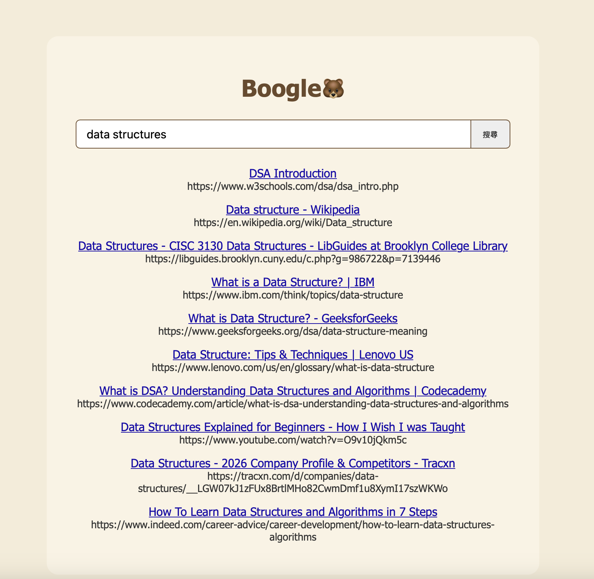
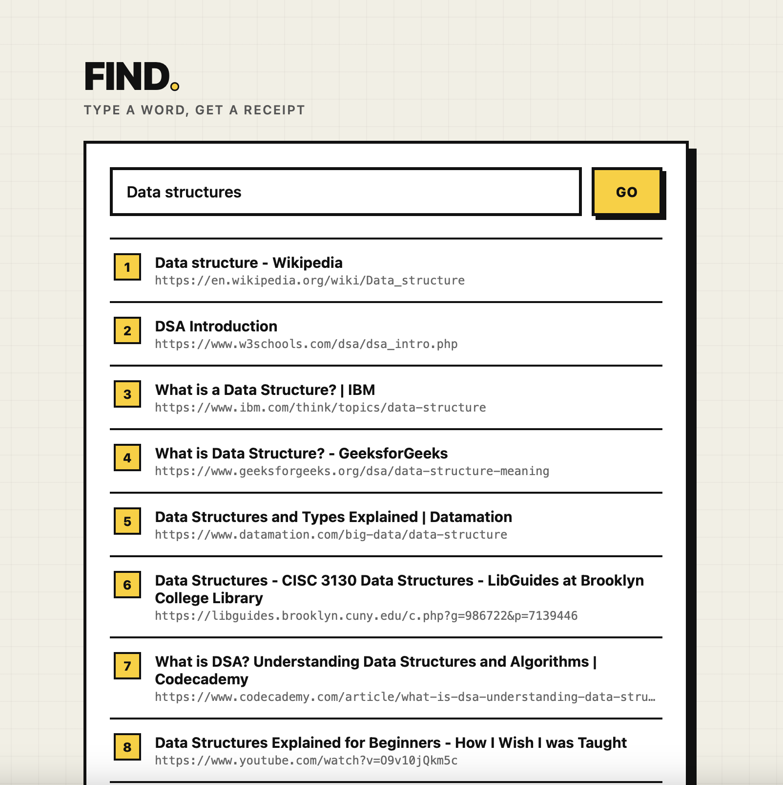

# HW8 - Use a Search API and Get the Links!

開發出你的搜尋引擎，本次作業僅需各位先嘗試連接到一個真實的搜尋引擎 API 後，將內容回傳至你自己的頁面。網頁排版設計不拘，可自由發揮，以下兩張僅供參考：

過去開發類似應用通常會直接呼叫 Google 提供的搜尋 API，但 Google 已經在 2026 年起停止對新用戶開放這項服務，因此這次作業改用 **Tavily Search API**。

 

（以上為示意圖，實際排版、配色、搜尋引擎名稱等皆可自行發揮，設計不影響此作業評分）

建議：查無結果時畫面不要顯示錯誤或空白，可以用類似「沒有找到結果」的提示文字處理。

請繳交：
- 隨意字詞搜尋結果的截圖
- 程式碼的公開 GitHub 連結

---

## 什麼是 Tavily Search API？

Tavily 是一個搜尋 API 服務，讓你可以用程式發送查詢字詞，直接拿到乾淨的 JSON 格式搜尋結果（標題、網址、摘要），不需要自己寫爬蟲或解析網頁 HTML。它提供每月 1,000 次免費查詢額度，申請帳號**不需要信用卡**。

---

提示：
1. 可使用 HW4 bonus 作為基礎來改寫功能。

2. 申請並呼叫 Tavily Search API，於`src/main/resources/application.properties` 設定：
    - tavily.enabled=true
    - tavily.apiKey=你的API金鑰

申請步驟：
    - 到 https://www.tavily.com 註冊帳號。
    - 到 https://app.tavily.com 的 Dashboard 取得 API 金鑰（格式類似 `tvly-xxxxxxxx`）。


⚠️ **注意：繳交時會附上公開的 GitHub 連結，請勿把 `application.properties` 裡真實的 `apiKey` 一起 commit 上去，避免金鑰外洩。建議把含有金鑰的設定另外抽出（例如用環境變數，或把該檔案加進 `.gitignore`）。**

3. （供參）Tavily 呼叫範例。這是一個完整的 Service 類別，`package` 路徑請改成跟你專案裡 `@SpringBootApplication` 那個主類別同一個套件樹下（否則 Spring 不會自動掃描到），檔名存成 `TavilySearchService.java`：
```java
package com.example.boogle.service;

import org.springframework.beans.factory.annotation.Value;
import org.springframework.http.HttpEntity;
import org.springframework.http.HttpHeaders;
import org.springframework.http.MediaType;
import org.springframework.http.ResponseEntity;
import org.springframework.stereotype.Service;
import org.springframework.web.client.RestTemplate;

import java.util.LinkedHashMap;
import java.util.List;
import java.util.Map;

@Service
public class TavilySearchService {

    @Value("${tavily.enabled:false}")
    private boolean enabled;

    @Value("${tavily.apiKey:}")
    private String apiKey;

    private final RestTemplate restTemplate = new RestTemplate();

    public Map<String, String> search(String query) {
        Map<String, String> results = new LinkedHashMap<>();

        if (!enabled) {
            return results;
        }

        HttpHeaders headers = new HttpHeaders();
        headers.setContentType(MediaType.APPLICATION_JSON);
        headers.setBearerAuth(apiKey);

        Map<String, Object> body = new LinkedHashMap<>();
        body.put("query", query);
        body.put("max_results", 10);

        HttpEntity<Map<String, Object>> request = new HttpEntity<>(body, headers);

        ResponseEntity<Map<String, Object>> resp =
                restTemplate.postForEntity("https://api.tavily.com/search", request, (Class<Map<String, Object>>) (Class<?>) Map.class);
        Map<String, Object> respBody = resp.getBody();
        if (respBody == null) {
            return results;
        }

        Object itemsObj = respBody.get("results");
        if (itemsObj instanceof List) {
            List<?> items = (List<?>) itemsObj;
            for (Object itemObj : items) {
                if (itemObj instanceof Map) {
                    Map<String, Object> item = (Map<String, Object>) itemObj;
                    Object titleObj = item.get("title");
                    Object urlObj = item.get("url");
                    String title = titleObj == null ? null : titleObj.toString();
                    String url = urlObj == null ? null : urlObj.toString();
                    if (title != null && !title.isEmpty() && url != null && !url.isEmpty()) {
                        results.put(title, url);
                    }
                }
            }
        }

        return results;
    }
}
```

這個類別只負責「呼叫 Tavily、把結果整理成 `Map<標題, 網址>`」，**不包含接收使用者輸入、串前端頁面的部分**，這些要自己接到 Controller 跟頁面上（可參考 HW4 bonus 的 `BmiController` 寫法）。

（更多參數、錯誤碼請參考 [Tavily API 文件](https://docs.tavily.com/documentation/api-reference/endpoint/search)）

4. SpringBoot  [詳細教學](https://kucw.io/blog/springboot/1/)

---

## Submission
- **Deadline:** 11/15 (Sunday) 23:59（No first submission this time）
- Upload screenshot and github link via **Moodle**.
- Just one copy per group.
